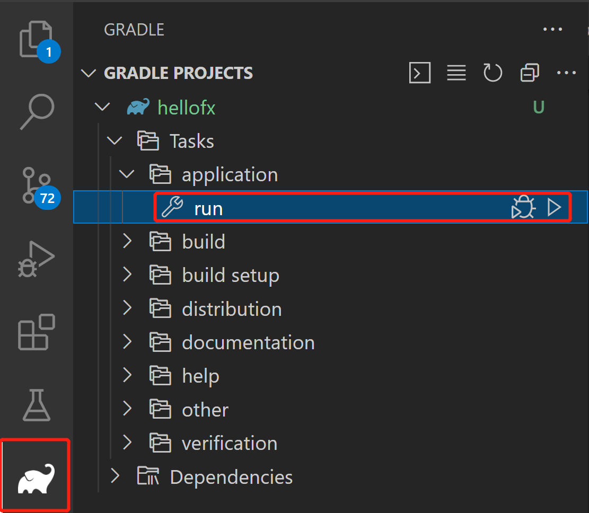

## Build instructions

This project is based on JavaFX. 
The sources are organized to be built using Gradle within Visual Studio Code.

This is derived from, non-modular sample:
https://github.com/openjfx/samples/tree/master

Download [JDK 17 or later](http://jdk.java.net/) for your operating system. Make sure `JAVA_HOME` is properly set to the JDK installation directory.

### Gradle

For the first time only:

- Make sure you have installed following extensions in your Visual Studio Code:
  - [Extension Pack for Java](https://marketplace.visualstudio.com/items?itemName=vscjava.vscode-java-pack)
  - [Gradle for Java](https://marketplace.visualstudio.com/items?itemName=vscjava.vscode-gradle)

To run the JavaFX application, you can open the `Gradle Projects` explorer, expand `hellofx` > `Tasks` > `application` and run the Gradle task: `run`

Or alternatively run from terminal:

On Linux or Mac run:

    cd IDE/VSCode/Non-Modular/Gradle/hellofx
    ./gradlew run

On Windows run:

    cd IDE\VSCode\Non-Modular\Gradle\hellofx
    .\gradlew.bat run
